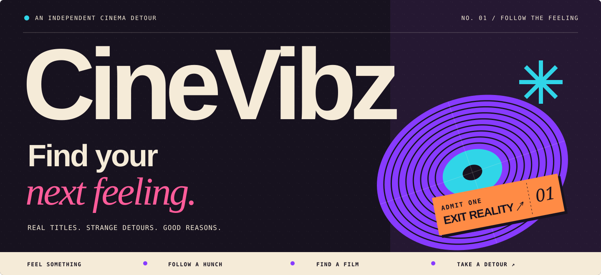
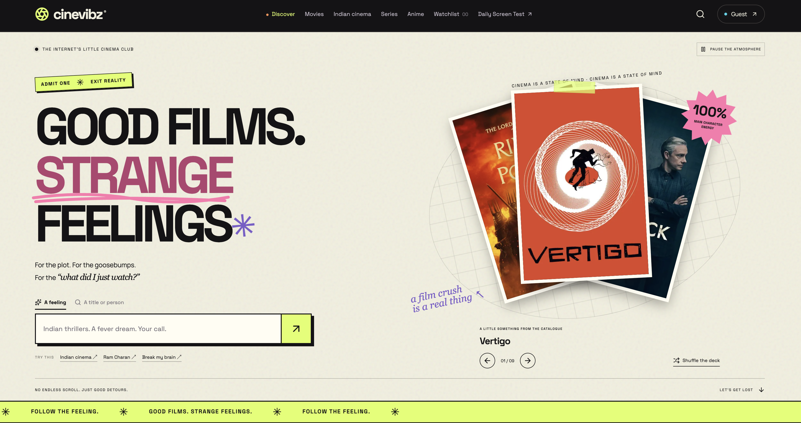
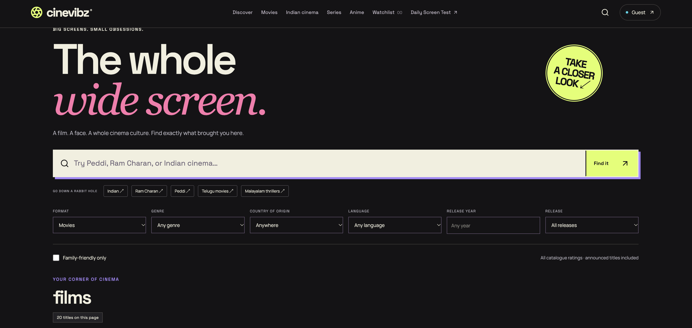
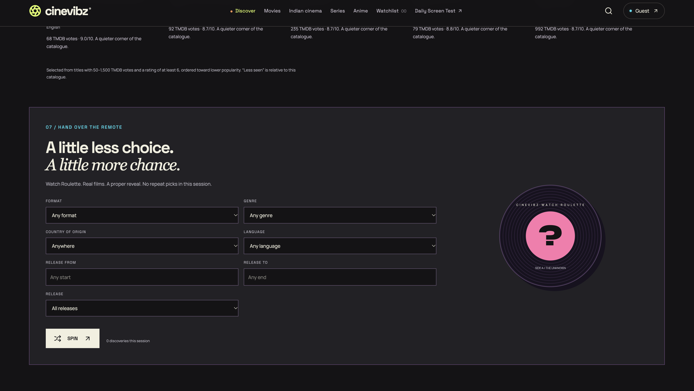
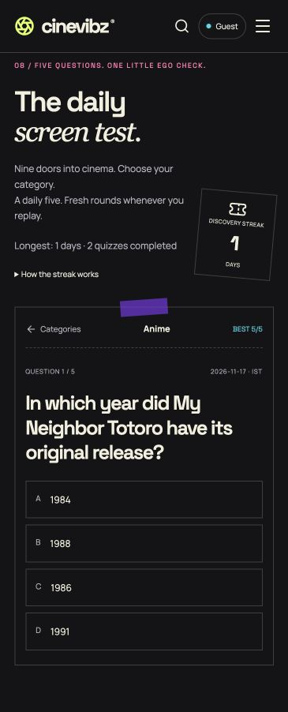
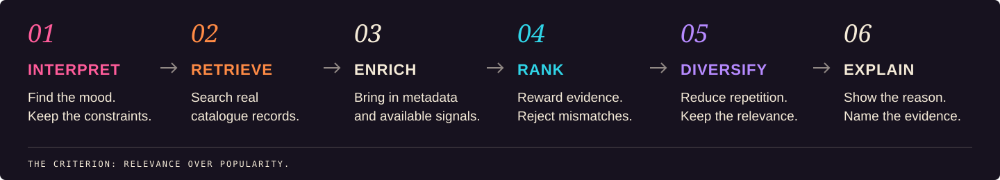
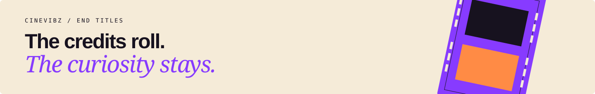

<a name="cinevibz"></a>

<div align="center">
  

  <h1>A feeling is a good place to start.</h1>

  <p><strong>Movies, series, anime and detours you didn’t see coming.</strong><br />
  A guest-first discovery app built around mood, real catalogue records and explained recommendations.</p>

  <p>
    <a href="https://nextjs.org/"></a>
    <a href="https://www.typescriptlang.org/"></a>
    <a href="https://tailwindcss.com/"></a>
    <a href="https://motion.dev/"></a>
    <a href="https://www.themoviedb.org/"></a>
    <a href="https://vercel.com/"></a>
  </p>

  <p><a href="https://github.com/GSIV2006/CINEVIBZ"><strong>THE REPOSITORY ↗</strong></a> &nbsp; / &nbsp; <a href="#screenshots">SCREENSHOTS</a> &nbsp; / &nbsp; <a href="#engine">THE ENGINE</a> &nbsp; / &nbsp; <a href="#run-locally">RUN IT</a></p>
</div>

<br />

<a name="screenshots"></a>

## 01 / A few frames

**The internet’s little cinema club.** A cream-paper opening, a restless poster deck, and a search that starts with a feeling, a film or a face.

[](docs/screenshots/homepage.png)

<table>
  <tr>
    <td width="50%" valign="top">
      <a href="docs/screenshots/catalogue-search.png"></a>
      <p><strong>A film. A face. A whole cinema culture.</strong><br />The catalogue search, with explicit filters.</p>
    </td>
    <td width="50%" valign="top">
      <a href="docs/screenshots/watch-roulette.png"></a>
      <p><strong>A little less choice. A little more chance.</strong><br />Watch Roulette, before the reveal.</p>
    </td>
  </tr>
</table>

<details>
<summary><strong>Small screen, same obsession — see the mobile quiz ↗</strong></summary>

<p align="center">
  
</p>

</details>

<sub>Real application captures. The three desktop images above were supplied by the project owner; the mobile image comes from the existing browser verification. Click a desktop image for its full resolution.</sub>

<br />

## 02 / Choose your detour

Start with **“Indian thrillers”**, **“a fever dream”** or **“something comforting”**. Follow a mood, revisit an old favourite, or let chance choose the next frame.

<table>
  <tr>
    <td width="50%" valign="top"><h3>✳ Mood Discovery</h3><p>Describe the experience you want. Get real titles ranked against the mood evidence and constraints the engine can recognise.</p></td>
    <td width="50%" valign="top"><h3>↗ Watchlist</h3><p>Keep the discoveries worth returning to. Save titles and mark them watched, without creating an account.</p></td>
  </tr>
  <tr>
    <td valign="top"><h3>Today’s Rabbit Hole</h3><p>A daily selection with editorial notes and “Why This Today?”. Stable through the India day, ready for a new detour at midnight.</p></td>
    <td valign="top"><h3>The Weekly Cut</h3><p>A themed edition with actual theme-based retrieval. Your week’s selection stays with you through Sunday.</p></td>
  </tr>
  <tr>
    <td valign="top"><h3>Popular Choices</h3><p>A dedicated feed of popular catalogue titles, for the nights when you want to see what the fuss is about.</p></td>
    <td valign="top"><h3>Trending Now</h3><p>A separate view of what’s currently trending. A different signal, with its own place in the discovery flow.</p></td>
  </tr>
  <tr>
    <td valign="top"><h3>Find Your Frequency</h3><p>Mood shortcuts into the recommendation engine. Find a starting point for nostalgic evenings and existential hours.</p></td>
    <td valign="top"><h3>Outside Your Algorithm</h3><p>A less-seen catalogue lane, ordered toward lower popularity. More room for titles you might otherwise scroll past.</p></td>
  </tr>
  <tr>
    <td valign="top"><h3>Watch Roulette</h3><p>Six format choices, real catalogue pools and an animated reveal. Filter the possibilities; exclude earlier picks in the session.</p></td>
    <td valign="top"><h3>Daily Screen Test</h3><p>Nine categories. Five questions per attempt. Sourced explanations, saved progress and fresh replay rounds that prioritise unseen questions.</p></td>
  </tr>
  <tr>
    <td valign="top"><h3>Today’s Feeling</h3><p>A daily prompt to chase. Find a matching title, save a favourite and complete the challenge toward your shared discovery streak.</p></td>
    <td valign="top"><h3>Your Rabbit Holes</h3><p>Revisit mood searches, explored titles, saves, spins, quizzes and challenges. Your history, with filters and erase controls.</p></td>
  </tr>
</table>

**Looking for something specific?** Exact-title search, verified actor/director credits and dedicated title pages keep the catalogue grounded. Indian cinema uses production-country constraints; South Indian cinema also uses regional original languages. Search for **Ram Charan** or **Peddi** to follow the actual records.

<br />

<a name="engine"></a>

## 03 / A reason for every recommendation

> **Relevance over popularity.** A title should earn its place through evidence that fits the request.

<picture>
  <source media="(max-width: 600px)" srcset="docs/readme/engine-mobile.svg" />
  
</picture>

The engine uses **deterministic interpretation and evidence-based ranking**. Known phrases become mood signals and explicit constraints; metadata supplies the evidence. Hard-filter violations are rejected, preference adjustments stay bounded, and low-evidence matches are omitted. **No LLM API is called.**

The limits matter too: catalogue metadata can be sparse, retrieval is finite, and visual style or pacing can be especially difficult to establish. Scores are **not probabilities of satisfaction**. The app explains the signals it found; it does not invent missing evidence.

[Read the architecture, filtering rules and ranking details →](docs/ENGINEERING.md#recommendation-architecture)

<br />

## 04 / In the projection booth

| Interface                               | Catalogue & logic                        | Delivery & checks                  |
| :-------------------------------------- | :--------------------------------------- | :--------------------------------- |
| Next.js App Router · React · TypeScript | TMDB · server-only API requests          | Vercel deployment configuration    |
| Tailwind CSS · Framer Motion · Lucide   | Deterministic interpretation and ranking | GitHub Actions · Vitest · Prettier |

**Guest-first, browser-local.** Watchlists, preferences, history and quiz progress stay in the browser, with cross-tab storage synchronisation. There is no account requirement or cross-device cloud sync. Supabase and paid AI APIs are not required.

**TMDB is the catalogue provider.** AniList is deliberately **not integrated**; its permission requirements must be cleared before use for this service.

<br />

<a name="run-locally"></a>

## 05 / Press play locally

Use **Node.js 24** and npm. Dependency versions are pinned; `.nvmrc` and `package.json` select the same Node major used by the GitHub workflow and Vercel configuration.

```bash
git clone https://github.com/GSIV2006/CINEVIBZ.git
cd CINEVIBZ
npm ci
```

Open the folder in **VS Code**. Create `.env.local` in the project root and add your [TMDB API Read Access Token](https://www.themoviedb.org/settings/api):

```dotenv
TMDB_READ_ACCESS_TOKEN=your_tmdb_read_access_token
```

Keep an existing configured `.env.local` intact. Use the **API Read Access Token**, as described in the [TMDB getting-started guide](https://developer.themoviedb.org/docs/getting-started).

```bash
npm run dev
```

Open **[localhost:3000](http://localhost:3000)**.

> **Keep the token server-only.** Never commit `.env.local`, paste the token into an issue, expose it in frontend code, or prefix it with `NEXT_PUBLIC_`. `.env.local` is ignored by Git. Missing or invalid credentials, rate limits and provider outages produce useful errors rather than fabricated results; guest lists and the sourced quiz still work.

**Ready to host?** Import the repository into Vercel as a Next.js project, using the folder containing `package.json`. Add `TMDB_READ_ACCESS_TOKEN` to Production, and Preview if needed, before deploying. The included configuration uses `npm ci` and `npm run build`. No database migrations are needed; localhost browser data does not migrate to the hosted domain.

[Push, environment setup and hosted checks →](docs/DEPLOYMENT.md)

<br />

## 06 / Show the work

Recorded local validation on **17 November 2026**:

| Automated tests | Curated mood / constraint requests | Real TMDB test fixtures |
| :-------------: | :--------------------------------: | :---------------------: |
| **120 passing** |               **38**               |     **28 records**      |

TypeScript, formatting and the production build passed, including a clean dependency installation without a local TMDB token. Fixtures are used only in tests; production does not import a fake catalogue. GitHub Actions runs the offline checks on pushes to `main` and pull requests without needing a TMDB secret.

```bash
npm run verify        # TypeScript + tests + production build
npm run format:check
```

**Passing tests does not prove perfect recommendations.** The corpus is small, metadata coverage varies, and relevance still needs human review. The quiz bank has **427 question variants** drawn from Academy facts and **61 verified TMDB records**; it is finite and eventually repeats.

| Read further                                                     | What you’ll find                                                                       |
| :--------------------------------------------------------------- | :------------------------------------------------------------------------------------- |
| [Engineering notes](docs/ENGINEERING.md)                         | Retrieval limits, scoring, content controls, caching and individual test commands      |
| [Validation](docs/VALIDATION.md)                                 | What was checked, live/browser evidence and what it does not prove                     |
| [Recommendation evaluation](docs/recommendation-evaluation.json) | Constraint compliance, duplicates, completeness, diversity and illustrative title hits |
| [Live catalogue checks](docs/catalogue-regressions-live.json)    | The 15 reported search and recommendation regression checks                            |
| [Live engagement checks](docs/engagement-live-checks.json)       | Daily curation, roulette and challenge integration                                     |
| [Quiz sources](docs/quiz-verification.json)                      | The record capture behind the sourced quiz facts                                       |
| [Deployment guide](docs/DEPLOYMENT.md)                           | GitHub, Vercel, environment variables and post-deployment checks                       |

<details>
<summary><strong>Before you get lost: storage, content controls and provider limits</strong></summary>

- **Daily means Asia/Kolkata.** Browser snapshots preserve daily editions until midnight and weekly editions through Sunday. These are local editions, not a global editorial archive; clearing storage or using another browser creates a new local edition. No separate cron job is required.
- **Content controls are conservative.** Adult-only TMDB entries are excluded. General-mode automatic recommendations additionally require recognised certification and can omit relevant international or unrated titles. Catalogue search can include mature/unrated titles, with an optional family-friendly filter. Ratings vary by region; this is not a parental-control guarantee.
- **Provider availability still matters.** Server requests use caching, deduplication, bounded concurrency, timeouts and explicit rate-limit handling. Provider usage limits apply. Public deployments should configure request protection and usage alerts for their traffic.
- **Personal activity stays local.** Watchlists, feedback, history and quiz progress are browser data. There is no account sync or globally shared editorial archive in this version.

The [engineering notes](docs/ENGINEERING.md) retain the full operational details and limits.

</details>

<br />

## 07 / Credits where they belong


**This product uses the TMDB API but is not endorsed or certified by TMDB.** Catalogue artwork belongs to its respective rights holders. Posters and backdrops come from the corresponding provider records.

Quiz facts link to official Academy ceremony records or exact TMDB title records. Interface fonts: **Syne, Space Grotesk and Manrope**. Icons: **Lucide**. The cinema eye and motion graphics are original HTML/CSS artwork; the README’s cover, diagram and end card are original SVGs. Application screenshots are real captures.

An independent project by **[G S I Venkat](https://www.linkedin.com/in/gsi-venkat-9a02083a3)**, exploring entertainment discovery, recommendation systems and expressive web design.

[Found a rough edge? Have a good detour? Open an issue ↗](https://github.com/GSIV2006/CINEVIBZ/issues)

<br />



<p align="center"><strong>CineVibz — Find your next feeling.</strong><br /><a href="#cinevibz">Back to the opening frame ↑</a></p>
